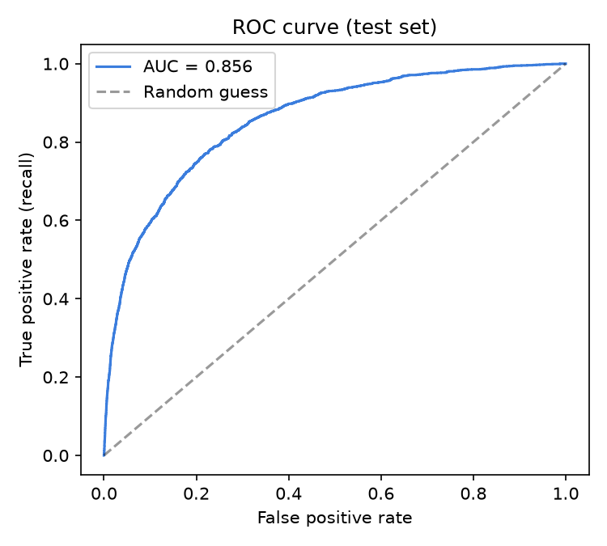
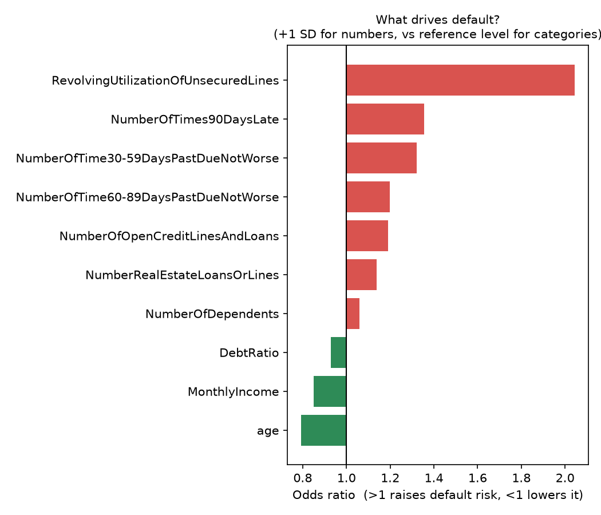
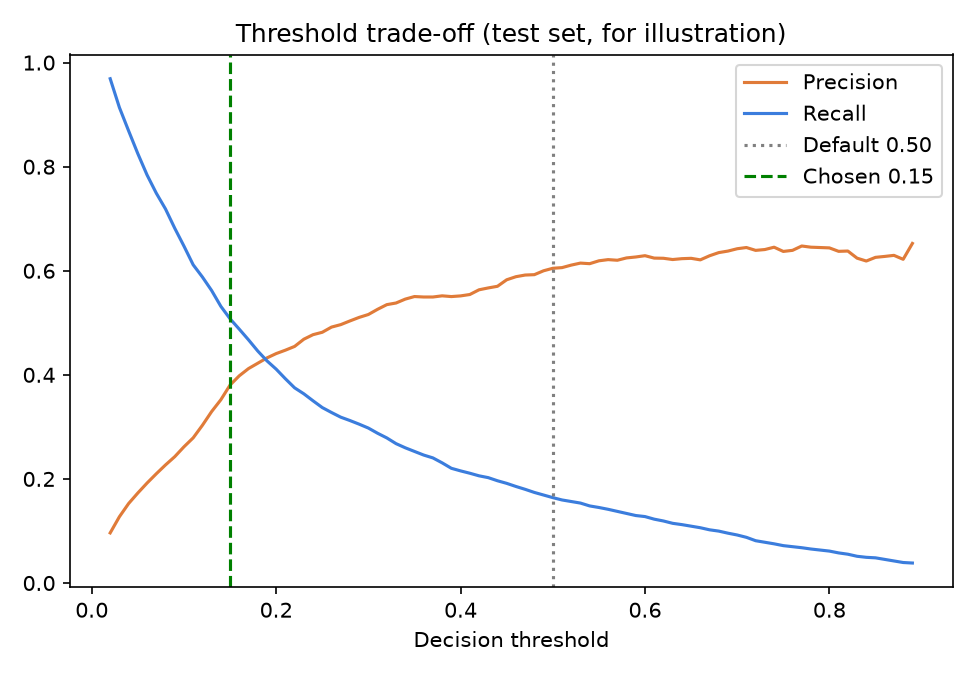
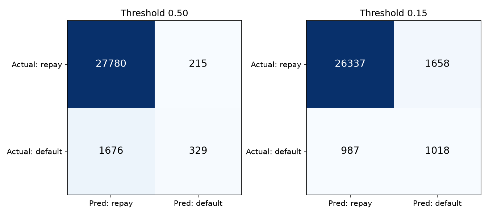
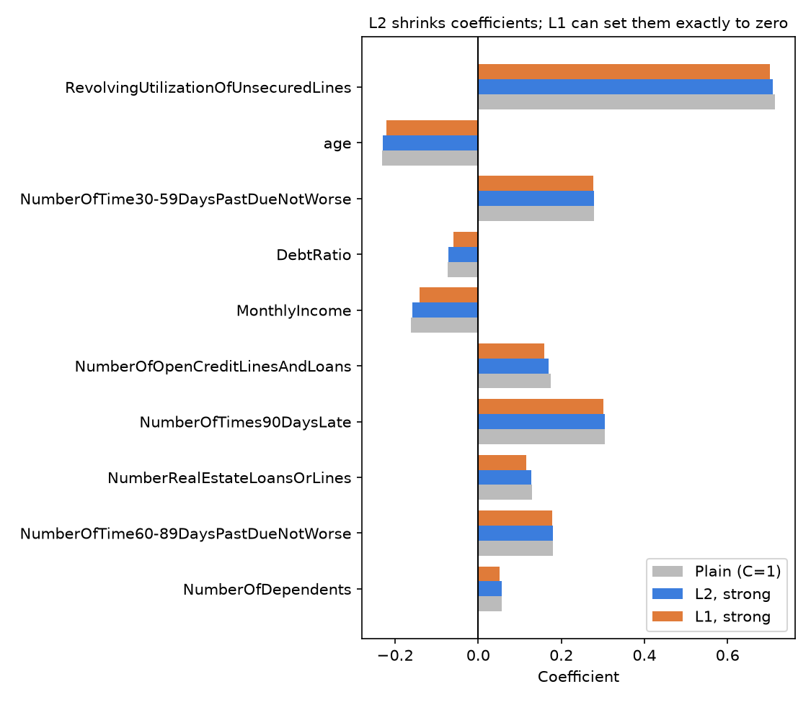

# Loan Default Prediction with Logistic Regression

A beginner-friendly, end-to-end project that predicts whether a borrower will **default on a loan**
and, more importantly, teaches the core ideas behind **logistic regression**:

- the algorithm written **from scratch in NumPy** (sigmoid, log-loss, gradient descent, L2),
  verified against scikit-learn,
- **reading the model** through coefficients and odds ratios,
- handling **class imbalance** (why accuracy misleads),
- choosing a **decision threshold from business costs**,
- **L1 vs L2** regularisation.

> **Data note:** `data/loan_data.csv` now holds **real data**: the Kaggle *Give Me Some Credit* training set
> (150,000 borrowers). The original made-up dataset is kept as `data/loan_data_synthetic_backup.csv`.
> See [Switching datasets](#switching-datasets) to rebuild the real file or go back to the synthetic one.

## Project structure

```
loan-default-prediction/
├── README.md
├── requirements.txt
├── prepare_data.py               # turns Kaggle's cs-training.csv into data/loan_data.csv
├── data/
│   ├── loan_data.csv             # the dataset the pipeline reads (real: ~150,000 borrowers, target = default)
│   └── loan_data_synthetic_backup.csv   # the original made-up dataset (10,000 rows)
├── src/
│   ├── logistic_scratch.py       # logistic regression in pure NumPy (read this first)
│   ├── train.py                  # full pipeline: preprocess, train, evaluate, interpret, plots
│   └── predict.py                # score applicants (default: first rows of the data, or your own CSV)
├── tests/
│   └── test_scratch.py           # checks our model matches scikit-learn
├── docs/
│   └── CONCEPTS.md               # the 6 key concepts in plain words + a self-test
├── reports/                      # charts and tables created by train.py
└── models/                       # saved model (created by train.py)
```

## Quick start

```bash
python -m venv .venv
source .venv/bin/activate            # Windows: .venv\Scripts\activate
pip install -r requirements.txt

python prepare_data.py            # only needed if you want to rebuild data/loan_data.csv (needs cs-training.csv)
python tests/test_scratch.py         # 4 quick checks
python src/train.py                  # trains everything, writes reports/ and models/
python src/predict.py                # score a few applicants (or: python src/predict.py my_file.csv)
```

Run commands from the project root. Everything is seeded (`42`), so results are reproducible.

## Dataset

Source: Kaggle competition [Give Me Some Credit](https://www.kaggle.com/competitions/GiveMeSomeCredit/data)
(file `cs-training.csv`, free Kaggle login, accept the competition rules). Real, anonymised credit-bureau style data
from 2011. It is subject to the competition rules, so check them before redistributing the raw file.

| | |
|---|---|
| Rows | 149,999 (one row with age 0 removed) |
| Target | `default` (1 = serious delinquency within 2 years; renamed from `SeriousDlqin2yrs`), **6.7%** of rows, so strongly imbalanced |
| Features (all numeric) | `RevolvingUtilizationOfUnsecuredLines`, `age`, `NumberOfTime30-59DaysPastDueNotWorse`, `DebtRatio`, `MonthlyIncome`, `NumberOfOpenCreditLinesAndLoans`, `NumberOfTimes90DaysLate`, `NumberRealEstateLoansOrLines`, `NumberOfTime60-89DaysPastDueNotWorse`, `NumberOfDependents` |
| Missing values | `MonthlyIncome` about 20% missing, `NumberOfDependents` about 2.6% missing (median-imputed) |
| Cleaning (`prepare_data.py`) | drop the unnamed index column, drop `age < 18`, clip every feature at its 99.5th percentile to tame extreme outliers |

There are no text columns, so one-hot encoding is skipped automatically.

## Method

1. **Split:** 80/20 stratified train/test (120,000 train rows, 30,000 test rows, 2,005 test defaulters).
2. **Preprocess** (fitted on train only): median imputation + standardisation for numbers (this dataset has no text columns; if yours has,
   most-frequent imputation + one-hot encoding is applied to them).
3. **Scratch model:** gradient descent on log-loss + L2, compared with `sklearn.LogisticRegression`.
4. **Evaluate:** accuracy, precision, recall, F1, ROC-AUC, PR-AUC, confusion matrices.
5. **Interpret:** coefficients to odds ratios.
6. **Threshold:** chosen by minimising expected cost (a missed defaulter costs 5x a wrongly rejected
   customer, an assumption you can change) using 5-fold out-of-fold predictions on **train only**.
7. **Regularisation:** L1 vs L2 at a strong penalty (`C = 0.02`).

## Results

> These numbers come from running `python src/train.py` on the real data in `data/loan_data.csv`
> (seed 42, so you should get the same values). If you change the data, update this section.

**1. The scratch model matches scikit-learn.** Largest coefficient difference: **about 0.0000001**; same test
metrics (1,851 gradient steps). (scikit-learn's default stopping tolerance `1e-4` halts after a few steps and leaves a
small gap, so `tol=1e-8` is used for a fair comparison.)

**2. Test-set performance at the default 0.50 threshold**

| Metric | Value |
|---|---|
| ROC-AUC | 0.856 |
| PR-AUC | 0.375 |
| Accuracy | 0.937 (an "always repay" model scores **0.933**) |
| Precision | 0.605 |
| Recall | **0.164** |
| F1 | 0.258 |

Accuracy looks excellent, but it is only 0.4 points above the lazy baseline, and the model **misses ~84% of defaulters**.
This is the class-imbalance trap, and it is stronger here than in the synthetic data because only 6.7% of rows default.

**3. Moving the threshold to 0.15 (chosen from costs on train data)**

| Threshold | Recall | Precision | Accuracy | Expected cost on test* |
|---|---|---|---|---|
| 0.50 | 0.164 | 0.605 | 0.937 | 8,595 |
| **0.15** | **0.508** | 0.380 | 0.912 | **6,593** (about 23% lower) |

\*cost = 5 x (missed defaulters) + 1 x (rejected good customers), under the stated assumption.
Accuracy drops on purpose: we accept more false alarms to catch many more defaulters.

**4. What drives default** (odds ratio per +1 SD; see `reports/odds_ratios.png`):

| Raises risk | Odds ratio | Lowers risk | Odds ratio |
|---|---|---|---|
| RevolvingUtilizationOfUnsecuredLines | 2.04 | age | 0.79 |
| NumberOfTimes90DaysLate | 1.36 | MonthlyIncome | 0.85 |
| NumberOfTime30-59DaysPastDueNotWorse | 1.32 | DebtRatio | 0.93 (see note below) |
| NumberOfTime60-89DaysPastDueNotWorse | 1.20 | | |
| NumberOfOpenCreditLinesAndLoans | 1.19 | | |
| NumberRealEstateLoansOrLines | 1.14 | | |
| NumberOfDependents | 1.06 | | |

Reading it: borrowers who use a large share of their credit limits (revolving utilisation) and who have been
late on payments are clearly riskier, and older borrowers and those with higher income are safer. These are the
patterns credit scoring is known for.

**5. L1 vs L2.** With 120,000 training rows, `C = 0.02` is not a strong enough penalty to push any coefficient to
exactly zero (L1 zeroed 0 of 10). Smaller `C` does it: in a quick check, `C = 0.002` zeroed `DebtRatio` and
`MonthlyIncome`, and `C = 0.001` also zeroed `NumberOfOpenCreditLinesAndLoans`, `NumberRealEstateLoansOrLines` and
`NumberOfDependents`. Try it by changing `C_STRONG` in `src/train.py`. More data means the same `C` penalises less.







## Limitations (read before quoting any number)

- **Old, narrow data:** the file is from a 2011 competition, with only 10 features and no loan terms (amount, rate,
  purpose). It is good for learning and benchmarking, not for making real lending decisions.
- **The `DebtRatio` oddity:** its odds ratio is below 1 (looks protective), which is not what you would expect.
  Rows with missing `MonthlyIncome` have a typical `DebtRatio` of about 1,159, versus about 0.30 for rows with income,
  so the column mixes a true ratio with what look like raw amounts. After median imputation and clipping, the
  coefficient is hard to interpret. A cleaner approach is to add a "income missing" flag and treat `DebtRatio` separately.
- **Correlated features:** the three "days past due" counts move together, so individual coefficients should be read
  with care (multicollinearity).
- Recall of 0.51 at the chosen threshold means about half of real defaulters are still missed. A linear model on
  10 features has limited power (ROC-AUC 0.856); tree-based models usually do better on this dataset.
- The 5:1 cost ratio is an assumption. Change `COST_FN` / `COST_FP` in `src/train.py` and watch the threshold move.
- Odds ratios describe association in this data, not cause and effect.
- No probability calibration, fairness checks or time-based validation. A real credit model needs all three.

## Switching datasets

The pipeline reads one file: `data/loan_data.csv`, which needs a **binary column named `default`**
(1 = defaulted / bad, 0 = repaid). All other columns can be numbers or text (text is one-hot encoded automatically).
After changing the file, re-run `python src/train.py` (the saved model depends on the columns).

**Rebuild the real data** (Give Me Some Credit): download `cs-training.csv` from the Kaggle competition page, put it in
the project root, and run `python prepare_data.py`.

**Go back to the synthetic data:** copy `data/loan_data_synthetic_backup.csv` over `data/loan_data.csv`, then re-run
`python src/train.py`. (It has 10,000 rows, 21.1% defaults and mixed numeric/text columns, and was generated with seed 42
from hidden rules, which is handy for checking that a method recovers a known answer.)

**Statlog German Credit** (UCI repository, dataset id 144; 1,000 rows, space-separated, no header, last column 1 = good, 2 = bad):

```python
import pandas as pd
cols = ["status_checking_account", "duration_months", "credit_history", "purpose", "credit_amount",
        "savings_account", "employment_since", "installment_rate", "personal_status_sex", "other_debtors",
        "residence_since", "property", "age", "other_installment_plans", "housing", "num_existing_credits",
        "job", "num_people_liable", "telephone", "foreign_worker", "default"]
df = pd.read_csv("german.data", sep=r"\s+", header=None, names=cols)
df["default"] = (df["default"] == 2).astype(int)
df = df.drop(columns=["personal_status_sex"])        # sensitive attribute, left out on purpose
df.to_csv("data/loan_data.csv", index=False)
```

**Your own Excel file** (`pip install openpyxl` once; make sure it has a 0/1 `default` column):

```python
import pandas as pd
pd.read_excel("my_file.xlsx").to_csv("data/loan_data.csv", index=False)
```

Note: the German Credit snippet was tested on a fake file of the same format, not on the real download.

## Ideas to extend

- Add `class_weight="balanced"` and compare with threshold tuning.
- Calibrate probabilities (`CalibratedClassifierCV`) and plot a calibration curve.
- Add a `MonthlyIncome`-missing flag, treat `DebtRatio` separately, and add interaction terms to see if AUC improves.
- Compare with a Gradient Boosting model and discuss the interpretability trade-off.
- Wrap `predict.py` in a small Streamlit app.

## Tech stack

Python, NumPy, pandas, scikit-learn, matplotlib, joblib.
